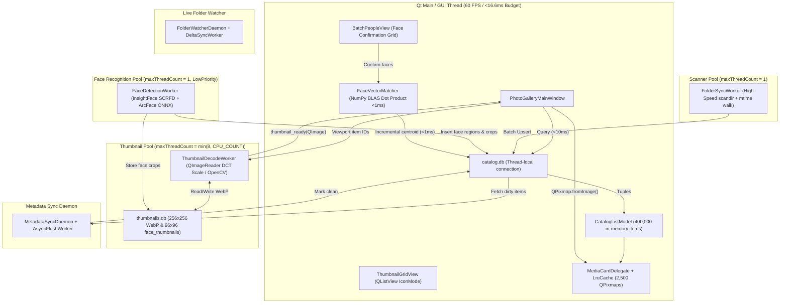

# PhotoGallery64 — As-Built System Architecture (`ARCHITECTURE.md`)

**Target Architecture:** Windows Live Photo Gallery (WLPG) Wave 4 (2012) 64-Bit Desktop Photo Manager (`Python 3.12+` + `PySide6` + `SQLite3 WAL` + `OpenCV/Pillow/NumPy`)  
**Scale Target:** 400,000+ Photos & Videos, 60 FPS Virtualised Grid, Sub-10ms Faceted Queries  
**Design Principles:** Non-destructive image editing, zero UI-thread blocking file I/O, strict SQLite WAL concurrency, standards-compliant dual XMP/MWG metadata interop, and local AI face clustering.

---

## 1. Exact Project File Tree

```text
Gallery/
├── main.py                                      # Application bootstrap, QApplication lifecycle, QSS stylesheet loader
├── SPEC.md                                      # System specification & feature requirements
├── ARCHITECTURE.md                              # As-built system architecture, data contracts, signal flows, shortcuts
├── db/
│   └── schema.sql                               # Complete SQLite DDL: WAL, R*Tree, closure tables, indexes, triggers
├── assets/
│   ├── app_icon.png
│   ├── icons/                                   # High-DPI UI icons & procedural SVG vector generators
│   └── themes/
│       ├── wlpg_aero.qss                        # Authentic Windows Live Photo Gallery Aero (Light) theme
│       ├── dark.qss                             # Dark studio theme
│       └── modern.qss                           # Modern neutral theme
├── docs/
│   └── archive/
│       ├── TASKS.md                             # Archived 8-phase implementation task tracking plan
│       └── AUDIT_AND_ROADMAP.md                 # Archived comprehensive architectural audit & work package roadmap
├── src/
│   ├── __init__.py
│   ├── core/
│   │   ├── __init__.py
│   │   ├── face_engine.py                       # FaceEngine: Dual InsightFace SCRFD+ArcFace & deterministic OpenCV fallback
│   │   └── face_matcher.py                      # FaceVectorMatcher: NumPy N×512 BLAS matrix similarity & running centroids (<1ms)
│   ├── db/
│   │   ├── __init__.py
│   │   ├── connection.py                        # DualDatabaseEngine: Thread-local WAL connection manager, backup & optimize
│   │   └── repository.py                        # CatalogRepository & ThumbnailRepository: Sub-10ms queries, R*Tree, tag_closure
│   ├── imaging/
│   │   ├── __init__.py
│   │   └── opencv_engine.py                     # OpenCV CLAHE auto-exposure, Hough straighten, Telea inpaint & effects
│   ├── ui/
│   │   ├── __init__.py
│   │   ├── batch_people_view.py                 # BatchPeopleView: Virtualised face suggestion confirmation grid & quick preview
│   │   ├── crop_tool.py                         # CropOverlayItem: Interactive Rule-of-Thirds overlay with aspect-ratio locks
│   │   ├── dialogs.py                           # AppSettingsDialog, ChangeTimeTakenDialog (relative Δt math), ResizeDialog
│   │   ├── grid_model.py                        # CatalogListModel (QAbstractListModel) with O(log G) binary-searched headers
│   │   ├── grid_view.py                         # ThumbnailGridView (QListView IconMode) & MediaCardDelegate (QStyledItemDelegate)
│   │   ├── left_nav_dock.py                     # LeftNavigationDock: Folders, Dates, Tags (AND/OR/NOT), People, Ratings
│   │   ├── main_window.py                       # PhotoGalleryMainWindow: Central coordinator, thread pools, status bar monitor
│   │   ├── map_view.py                          # WorldMapView: QWebEngineView + Leaflet + QWebChannel + media_rtree bridge
│   │   ├── media_viewer.py                      # SingleMediaViewer: Async full-res ImageGraphicsView, video player, recipe engine
│   │   ├── ribbon_toolbar.py                    # RibbonToolbar: Home, Edit, Find, Create, View tabs, QAT, responsive resizing
│   │   ├── right_tag_dock.py                    # TagAndCaptionDock: Info (Ctrl+I) & Fine Tune (Ctrl+F) docks with live histogram
│   │   └── slideshow_view.py                    # FullscreenSlideshowDialog: Ken Burns Pan/Zoom, Cross-fade, and HUD overlays
│   ├── utils/
│   │   ├── __init__.py
│   │   └── geotag_resolver.py                   # Offline Gazetteer of 160+ cities & coordinate string parser
│   └── workers/
│       ├── __init__.py
│       ├── face_worker.py                       # FaceDetectionWorker: 3-stage background detector, crop extractor & backfill
│       ├── folder_watcher.py                    # FolderWatcherDaemon & DeltaSyncWorker: QFileSystemWatcher + startup reconciliation
│       ├── scanner_thumb_worker.py              # FolderSyncWorker, ThumbnailDecodeWorker (QImageReader + OpenCV filmstrip)
│       └── xmp_sync_worker.py                   # MetadataSyncDaemon: Lossless XMP/EXIF writer, mtime preservation, safe mode
├── legacy_reference/
│   └── imgBrowserv13.py                         # Historical reference implementation (isolated utility classes)
└── tests/
    ├── test_phase1_db.py                        # Database schema, WAL concurrency, tag_closure, R*Tree, time shift tests
    ├── test_phase2_workers.py                   # Scanner, QImageReader WebP thumbnails, XMP dirty queue tests
    ├── test_phase3_grid.py                      # Virtualized model, group headers, delegate hit-testing, selection tests
    ├── test_phase4_nav_ribbon.py                # Left tree Boolean tag filters, Ribbon arrange/details/face carousel tests
    ├── test_phase5_dock_dialogs.py              # Right dock Info/Fine-Tune, relative time shift dialog, multi-tags tests
    ├── test_phase6_viewer_map.py                # Single image viewer, CropScene, lossless rotate, Leaflet Map R*Tree tests
    ├── test_phase7_main_window.py               # Main window coordinator, central stack transitions, shortcuts tests
    ├── test_phase8a_face_matcher.py             # FaceVectorMatcher, NumPy dot product, centroid math, rejection persistence
    ├── test_phase8b_batch_people_ui.py          # BatchPeopleView, grouped suggestions, avatar filter strip, shortcuts tests
    ├── test_face_engine.py                      # Dual-backend face detection, ArcFace embedding extraction, WebP crops
    ├── test_face_worker.py                      # FaceDetectionWorker 3-stage pipeline, cancellation, poison-pill isolation
    ├── test_wp09_face_repository.py             # Face region persistence, deduplication, state transitions, migration
    ├── test_wp09b_external_edits_and_edge_cases.py # 7 Real-world archive edge case hardenings (renames, crops, corrupt files)
    ├── test_xmp_standards_and_face_transforms.py # MWG center vs. MP top-left coordinates, ratings, face transforms on rotate/crop
    └── test_production_safeguards.py            # Safe Mode write-back pause, online backup, ANALYZE, RAW sidecar isolation
```

---

## 2. Database Schema & Dual-Database Storage Architecture

SQLite WAL mode (`PRAGMA journal_mode = WAL; PRAGMA synchronous = NORMAL; PRAGMA busy_timeout = 5000;`) is used across two isolated database files to eliminate write lock contention between thumbnail BLOB insertion and metadata querying.

### 2.1 `catalog.db` Tables & Indexes

```text
catalog.db
├── folders (id, path UNIQUE, name, parent_id, mtime, is_missing)
├── media (id, folder_id, filename, ext, size, mtime, date_taken, rating, flag, width, height,
│          orientation, lat, lon, location_name, caption, author, camera_make, camera_model,
│          exposure_time, f_number, focal_length, iso, is_video, duration_ms, video_codec,
│          video_fps, metadata_dirty, face_scan_version, is_missing)
├── tags (id, parent_id, name, full_path UNIQUE)
├── media_tags (media_id, tag_id) [PK: (media_id, tag_id)]
├── tag_closure (ancestor_id, descendant_id, depth) [PK: (ancestor_id, descendant_id)]
├── people (id, name UNIQUE, thumbnail_blob, avatar_media_people_id, centroid_embedding, confirmed_count)
├── media_people (id, media_id, person_id, suggested_person_id, similarity_score, state, is_manual,
│                 rect_x, rect_y, rect_w, rect_h, embedding)
├── face_rejected_suggestions (face_id, person_id, rejected_at) [PK: (face_id, person_id)]
└── media_rtree (id, min_lat, max_lat, min_lon, max_lon) [SQLite R*Tree Virtual Table]
```

#### Specialized High-Performance Indexes
- `idx_media_folder`: `media(folder_id)`
- `idx_media_date`: `media(date_taken)`
- `idx_media_rating`: `media(rating)`
- `idx_media_flag`: `media(flag) WHERE flag = 1`
- `idx_media_dirty_partial`: `media(id) WHERE metadata_dirty = 1`
- `idx_media_face_scan`: `media(face_scan_version) WHERE is_video = 0`
- `idx_media_is_missing`: `media(is_missing) WHERE is_missing = 1`
- `idx_media_people_suggested`: `media_people(suggested_person_id, similarity_score) WHERE state = 0`
- `idx_tag_closure_desc`: `tag_closure(descendant_id)`

### 2.2 `thumbnails.db` Tables
- **`thumbnails (media_id INTEGER PRIMARY KEY, webp_blob BLOB NOT NULL, mtime INTEGER, width INTEGER, height INTEGER)`**: Stores pre-computed $256 \times 256$ WebP thumbnails with an 8-byte magic header (`PG64THMB`).
- **`face_thumbnails (face_id INTEGER PRIMARY KEY, crop_webp BLOB NOT NULL)`**: Stores square $96 \times 96$ normalized portrait face crops used in `BatchPeopleView` and the Quick Find Face Carousel.

---

## 3. Class Interfaces & Data Contracts

### 3.1 Database Layer (`src/db/`)

#### `DualDatabaseEngine` (`src/db/connection.py`)
Thread-local SQLite connection manager:
- `catalog_conn() -> sqlite3.Connection`: Returns current thread's connection to `catalog.db`.
- `thumbnails_conn() -> sqlite3.Connection`: Returns current thread's connection to `thumbnails.db`.
- `analyze_catalog()`: Executes `ANALYZE;` to populate `sqlite_stat1` query planner statistics.
- `backup_catalog(destination_path, pages=250)`: Creates a consistent online database snapshot via `sqlite3.Connection.backup()`.
- `close_thread_connections()`: Runs `PRAGMA optimize;` and closes connections for worker threads.
- `close_all()`: Runs `PRAGMA optimize;` across all tracked connections and closes them at shutdown.

#### `CatalogRepository` (`src/db/repository.py`)
- `query_media_keys(filter_spec: FilterQuerySpec) -> list[MediaRowTuple]`: High-performance C-struct/tuple extraction returning 400,000 items in `<10ms`.
- `get_date_tree_counts(folder_id=None)`: Groups year/month/day counts directly in SQLite using epoch math.
- `apply_relative_time_shift(media_ids, lead_id, new_lead_epoch)`: Updates multiple photos by a relative $\Delta t$ offset in a single SQLite transaction.
- `confirm_faces(person_id, face_ids)`: Atomically updates `media_people.state = 1`, `metadata_dirty = 1`, and increments `people.confirmed_count`.
- `reject_face_suggestion(face_id, person_id)`: Records permanent exclusion in `face_rejected_suggestions`.
- `rotate_lossless(media_ids, clockwise=True)`: Losslessly updates EXIF orientation and re-maps all face bounding boxes for $90^\circ$ CW/CCW.
- `transform_face_regions_for_crop(media_id, crop_x, crop_y, crop_w, crop_h)`: Re-normalizes face regions to the crop box; deletes faces cropped below 25% visible threshold.

---

## 4. Signal Flow & Architectural Communication Bus

| Emitting Component | Signal | Purpose / Payload | Handling Slot(s) |
| :--- | :--- | :--- | :--- |
| `FolderSyncWorker` | `progress(int, str)` | Files scanned in current directory (`count`, `folder_name`) | `PhotoGalleryMainWindow.on_sync_progress` |
| `FolderSyncWorker` | `finished(int, bool)` | Scan pass completed (`total_synced`, `was_completed`) | `PhotoGalleryMainWindow.on_sync_finished` |
| `FolderWatcherDaemon` | `delta_completed(str, int, int, int)` | File changes detected in watched directory | `PhotoGalleryMainWindow._on_folder_watcher_delta` |
| `FolderWatcherDaemon` | `reconciliation_completed(...)` | Offline startup changes reconciled | `PhotoGalleryMainWindow._on_startup_reconciliation_completed` |
| `ThumbnailDecodeWorker` | `thumbnail_ready(int, QImage)` | $256 \times 256$ WebP thumbnail decoded | `PhotoGalleryMainWindow.on_thumbnail_decoded` |
| `MetadataSyncDaemon` | `batch_synced(list[int])` | XMP/EXIF written to disk; `metadata_dirty` cleared | `PhotoGalleryMainWindow.on_metadata_batch_synced` |
| `MetadataSyncDaemon` | `sync_error(int, str)` | Error during disk metadata serialization | `PhotoGalleryMainWindow.on_worker_error` |
| `FaceDetectionWorker` | `batch_progressed(int, int)` | Face detection progress (`current`, `total`) | `PhotoGalleryMainWindow.on_face_batch_progressed` |
| `FaceDetectionWorker` | `suggestions_updated()` | New face clusters or centroids ready | `PhotoGalleryMainWindow.on_face_suggestions_updated` |
| `MediaCardDelegate` | `rating_clicked(int, int)` | User clicked 1..5 star rating on card | `PhotoGalleryMainWindow.on_inline_rating_changed` |
| `MediaCardDelegate` | `flag_toggled(int, int)` | User clicked flag pin on card | `PhotoGalleryMainWindow.on_inline_flag_changed` |
| `ThumbnailGridView` | `selection_ids_changed(list, int)` | Grid selection changed (`selected_ids`, `lead_id`) | `PhotoGalleryMainWindow.on_grid_selection_changed` |
| `ThumbnailGridView` | `media_activated(int)` | Card double-clicked or Enter pressed | `PhotoGalleryMainWindow.open_single_viewer` |
| `LeftNavigationDock` | `filter_changed()` | Tree filter selection changed | `PhotoGalleryMainWindow.rebuild_and_run_query` |
| `LeftNavigationDock` | `files_dropped_on_folder(...)` | Drag-and-drop file move/copy requested | `PhotoGalleryMainWindow._on_files_dropped_on_folder` |
| `RibbonToolbar` | `action_triggered(str)` | Ribbon button clicked (e.g. `batch_people_tag`) | `PhotoGalleryMainWindow.dispatch_ribbon_action` |
| `TagAndCaptionDock` | `caption_committed(str)` | Caption edited and committed | `PhotoGalleryMainWindow.apply_caption_to_selection` |
| `TagAndCaptionDock` | `tag_added(str)` / `tag_removed(int)` | Descriptive tag chip added or removed | `PhotoGalleryMainWindow.on_selection_tag_modified` |
| `SingleMediaViewer` | `closed()` | Esc pressed in single viewer | `PhotoGalleryMainWindow.show_grid_view` |
| `WorldMapView` | `filter_to_bbox_requested(...)` | Map bounding box filter applied | `PhotoGalleryMainWindow.on_map_bbox_filter_requested` |
| `BatchPeopleView` | `faces_confirmed(int, list)` | Face suggestions confirmed in batch | `PhotoGalleryMainWindow._on_batch_faces_confirmed` |
| `BatchPeopleView` | `faces_rejected(list)` | Face suggestions rejected in batch | `PhotoGalleryMainWindow._on_batch_faces_rejected` |
| `BatchPeopleView` | `back_to_gallery_requested` | Esc or Back button clicked in batch view | `PhotoGalleryMainWindow.close_batch_people_view` |

---

## 5. Threading Model & Concurrency Boundaries



---

## 6. Keyboard Shortcuts & Ergonomics Reference

### 6.1 Gallery & Grid View
- <kbd>Ctrl</kbd> + <kbd>A</kbd>: Select all visible media items in the active filter.
- <kbd>Space</kbd> / <kbd>Enter</kbd>: Open the selected photo/video in Single Media Viewer.
- <kbd>Delete</kbd>: Move selected items to the OS Recycle Bin (`send2trash`).
- <kbd>Ctrl</kbd> + <kbd>0</kbd>: Toggle actual size ($100\%$) / fit to window.
- <kbd>Ctrl</kbd> + <kbd>+</kbd> / <kbd>-</kbd>: Zoom thumbnails in/out.
- <kbd>Ctrl</kbd> + <kbd>I</kbd>: Toggle Right "Tag and Caption" pane.
- <kbd>Ctrl</kbd> + <kbd>F</kbd>: Toggle Right "Fine Tune" adjustment pane.
- <kbd>Ctrl</kbd> + <kbd>Z</kbd> / <kbd>Ctrl</kbd> + <kbd>Y</kbd>: Undo / Redo rating, flag, caption, rotate, or geotag edits.
- <kbd>F11</kbd> / <kbd>F12</kbd>: Launch Fullscreen Slideshow.
- <kbd>Ctrl</kbd> + <kbd>F1</kbd>: Minimize / expand the Ribbon toolbar.

### 6.2 Single Media Viewer & Non-Destructive Editor
- <kbd>Esc</kbd>: Exit viewer and return to the thumbnail grid.
- <kbd>Left</kbd> / <kbd>Right</kbd> Arrow: Navigate to the previous / next photo in the current filter.
- <kbd>Space</kbd>: Next photo (or toggle video play/pause for video files).
- <kbd>Delete</kbd>: Move currently viewed photo to Recycle Bin.
- <kbd>0</kbd> .. <kbd>5</kbd>: Instantly rate the photo 0 to 5 stars.
- <kbd>C</kbd>: Toggle Crop Mode (Rule-of-Thirds overlay).
- <kbd>R</kbd>: Toggle Retouch / Spot Healing Mode.
- <kbd>Ctrl</kbd> + <kbd>Scroll Wheel</kbd>: Smooth interactive canvas zoom centered on cursor.

### 6.3 Batch People Tag Confirmation View
- <kbd>Enter</kbd>: Confirm all currently selected face suggestions.
- <kbd>Delete</kbd> / <kbd>Backspace</kbd>: Reject suggestions ("Not this person", logged to permanent rejections).
- <kbd>I</kbd>: "Don't show again" (`state = -2`).
- <kbd>Space</kbd>: Non-modal quick full-photo preview popup centered on the face box with highlight.
- <kbd>Ctrl</kbd> + <kbd>A</kbd>: Select all face cards across all visible person group sections.
- <kbd>Esc</kbd>: Return to Gallery.

---

## 7. Production-Readiness Safeguards

Before running against live 400,000+ photo archives, the application incorporates five safety guards:

1. **"Pause File Write-Back (Safe Mode)" (`MetadataSyncDaemon`):**
   - Visible toggle in the `File` menu and `Options` dialog.
   - When enabled, changes made to tags, ratings, captions, and people are queued in `catalog.db` (`metadata_dirty = 1`) without touching any files on disk.
   - Status bar displays `[Write-Back Paused: N pending]`. Unpausing drains the queue safely.
2. **Status Bar Background Task Monitor & Pause Button:**
   - Permanent status bar widget reporting live status: `Scanning: Idle | Faces: Idle | Sync: Idle`.
   - `[Pause Workers]` button instantly suspends background scanning, face detection, and metadata flushes.
3. **Online SQLite Backup & Query Planner Optimization:**
   - `File -> Backup Catalog...` invokes SQLite's online backup API (`sqlite3.Connection.backup()`), creating a safe, consistent snapshot without locking WAL readers/writers.
   - Automatically executes `ANALYZE;` after major folder imports ($>1,000$ files) so `sqlite_stat1` keeps 400,000-row Boolean tag and date join plans optimal.
   - Executes `PRAGMA optimize;` before closing database connections.
4. **Camera RAW Container Isolation:**
   - Proprietary RAW extensions (`.raf`, `.cr2`, `.cr3`, `.nef`, `.arw`, `.dng`, `.orf`, `.rw2`) **NEVER** undergo direct container modification.
   - Metadata edits for RAW files are strictly serialized to standards-compliant `.xmp` sidecar files (`filename.ext.xmp`).
5. **HEIC / HEIF & Corrupt File Poison-Pill Resilience:**
   - Safely registers `pillow_heif` opener at module initialization if installed.
   - Unreadable or corrupt files are tagged with `face_scan_version = -1`, preventing infinite crash loops on subsequent application launches.
